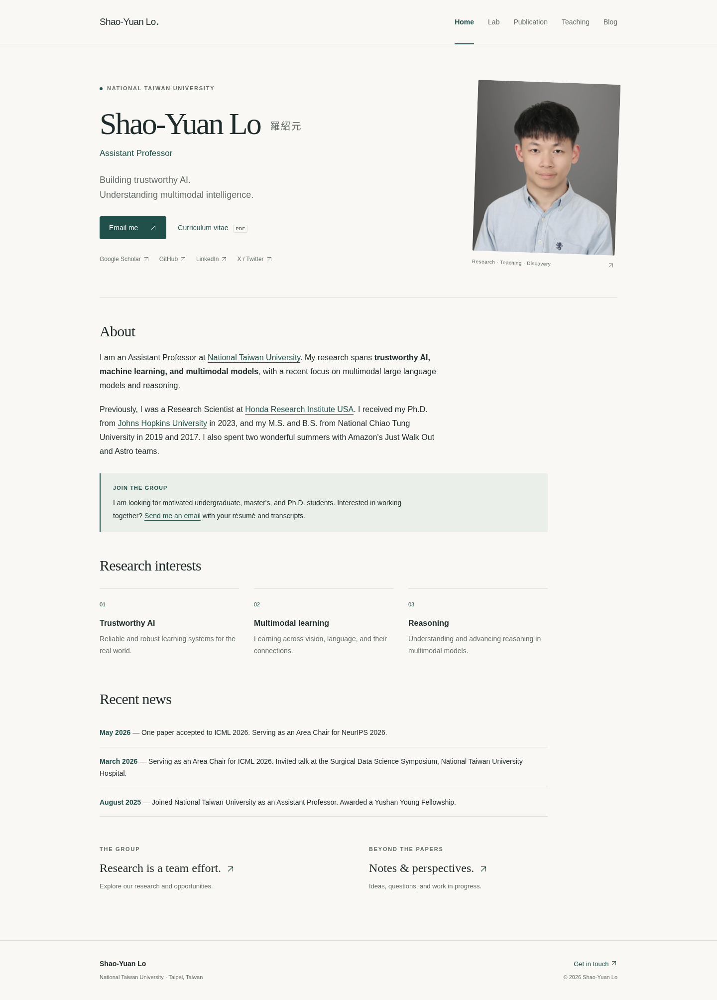
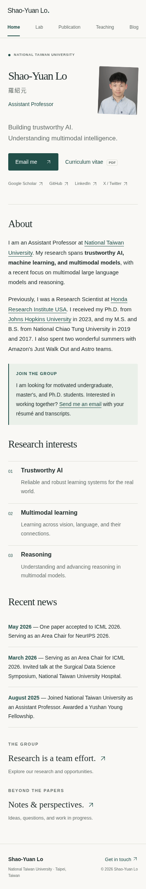

# Shao-Yuan Lo · Academic website

A small, English-first academic website with five separate pages, a sticky navigation bar, and a mobile layout. Content is plain **Markdown**. There is no CMS, database, or client-side JavaScript; pages and navigation also work with JavaScript disabled.

Built with [Eleventy](https://www.11ty.dev/) and deployed as static HTML to GitHub Pages. No paid service, API key, or custom domain is required.

## 網站預覽

代理預覽需要儲存庫允許公開讀取。**若未登入 GitHub 時開啟 `codex_test` 會得到 404，這個代理網址尚無法使用**；必須先由擁有者決定是否將儲存庫改為 Public。請勿為了測試而公開包含機密的儲存庫。

公開讀取開通後，預覽網址為：

**https://raw.githack.com/shaoyuanlo/codex_test/site-preview/index.html**

這套預覽提供實際的多頁網站：可以點擊導覽、閱讀文章、開啟 CV，並使用手機瀏覽。由 raw.githack 代理提供公開儲存庫 `site-preview` 分支中的靜態網頁，不需要先開啟 GitHub Pages，也不會取代原本的正式網站。工作流程會在儲存庫改為公開時執行，亦可在 Actions 手動執行；維持私有時會跳過公開代理發布。

更新方式：修改 **`main` 分支**的 `src/` 內容並提交 → 等待 **Update interactive website preview** 工作流程成功 → 重新整理上方預覽網址。這是提交後的自動建置預覽，不是逐字即時更新；第三方代理可能有短暫快取。請勿手動編輯 `site-preview` 分支，因為它會被自動產生的檔案更新。

預覽狀態可在 [Actions](https://github.com/shaoyuanlo/codex_test/actions/workflows/preview.yml) 查看。若 Actions 被停用，或儲存庫政策不允許工作流程寫入分支，自動更新會失敗；請啟用 Actions 並確認此工作流程獲允許使用 `contents: write`。此預覽使用公開檔案，不需要新增個人存取權杖。

工作流程也會實際請求代理上的首頁、Lab、樣式檔與英文字／中文字型，並將檢查結果存為 `site-preview` 分支中的 `preview-health.json`。這可區分「已產生檔案」與「外部代理確實可讀取」。

預覽圖片也與程式碼一起保存在這個儲存庫：

- [桌機版完整預覽](docs/preview/home-desktop.png)
- [手機版完整預覽](docs/preview/home-mobile.png)

<a href="docs/preview/home-desktop.png"></a>

<details>
<summary>展開手機版預覽</summary>



</details>

## 日常更新：只需修改文字

不需要修改版型，也不需要在電腦安裝軟體。網站部署完成後，在 GitHub 開啟以下檔案 → 按鉛筆編輯 → Commit 到 `main`，GitHub Actions 就會自動重新發布。建置失敗時不會覆蓋上一次成功發布的網站。

| 要更新的內容 | 修改的檔案 |
| --- | --- |
| Home 簡介、研究方向、最新消息 | [`src/index.md`](src/index.md) |
| Lab 介紹、成員、招生資訊 | [`src/lab.md`](src/lab.md) |
| 論文清單 | [`src/publication.md`](src/publication.md) |
| 課程與教材 | [`src/teaching.md`](src/teaching.md) |
| 新增文章 | 在 [`src/posts/`](src/posts/) 新增 `.md` 檔案 |
| 姓名、職稱、學校、Email、社群連結、首頁標語 | [`src/_data/site.json`](src/_data/site.json) |
| 首頁按鈕文字 | [`src/_includes/layouts/home.njk`](src/_includes/layouts/home.njk) |
| 各頁標題下方的簡介 | 各頁頂端 `intro:` 欄位 |
| 個人照片 | 替換 `src/assets/portrait.webp`（建議 5:6 比例） |
| 瀏覽器分頁圖示／台大校徽 | [`src/assets/ntu-emblem.png`](src/assets/ntu-emblem.png) |
| CV | 替換 `files/SYLo_CV.pdf`，檔名保留即可 |
| 配色、字體、間距 | [`src/assets/style.css`](src/assets/style.css) 開頭的變數 |

導覽列尺寸也在 `src/assets/style.css`：`.header-inner` 的 `min-height` 設定最低高度（桌機 `60px`、手機 `80px`）。選單固定使用 `16px`，左側姓名固定使用 `18px`，桌機與手機一致。手機區塊僅調整版面與間距，不再覆寫字級；窄螢幕時選單可自動換行，實際高度也會受內距及內容影響。

字級選項集中在 CSS 上方 `:root` 的顏色設定之後，各元素透過 `var(...)` 使用，避免另寫零散字級：

| 字級變數 | 大小 | 使用位置（桌機、手機相同） |
| --- | --- | --- |
| `--font-size-sm` | `14px` | 頁尾資訊 |
| `--font-size-base` | `16px` | 一般內文、導覽選單，以及未特別指定的項目 |
| `--font-size-lg` | `18px` | 導覽列左側姓名、論文標題 |
| `--font-size-xl` | `28px` | 區塊標題（內容中的 `h2`） |
| `--font-size-2xl` | `36px` | 首頁英文姓名、各分頁及 Blog 文章主標題 |

字重只使用 **400（一般）**與 **600（粗體）**，預設 400。Markdown 的 `**粗體文字**`、HTML 的 `strong`／`b`、目前導覽頁面的強調狀態等使用 600。正文、提示框、程式碼、中文姓名、社群連結等未指定項目皆使用 16px；只有頁尾統一繼承 14px。

全站字型統一由 `style.css` 的 `--font: "Inter", "Noto Sans TC", system-ui, sans-serif` 設定：英文優先使用 Inter，中文使用 Noto Sans TC，載入失敗或缺字時使用系統預設字型。標題、內文、導覽、中文姓名與程式碼都沿用這一組字型；字級限用上述五項，字重限用 400／600。原本的 `--serif`、`--sans` 已移除。字型檔存於 `src/assets/fonts/`，以分段 WOFF2 按需載入，採 `font-display: swap`，不依賴外部字型 CDN；來源版本及授權分別保存在 `sources.json` 與各字型目錄的 `LICENSE.txt`。

配色維持白色頁面背景、黑色一般文字、主藍互動與少量強調文字。導覽橫幅使用主藍底、白字，深藍按鈕也使用白字；首頁職稱、提示框標籤、研究編號及消息日期沿用主藍。提示框與程式碼區塊恢復淺藍背景，分隔線與邊框共用這個淺藍色。文字反白使用較深的藍底，搭配黑字。介面文字僅使用黑、白、主藍三色。

介面配色集中在 `style.css` 開頭的 `:root`：

| 設定 | 色碼 | 用途 |
| --- | --- | --- |
| `--white` | `#FFFFFF` | 頁面背景、導覽與按鈕白字、導覽選取底線及鍵盤焦點標示 |
| `--black` | `#000000` | 大多數一般文字、標題、日期、圖片說明、反白文字 |
| `--accent` | `#002D72` | 連結、導覽背景、按鈕底色、少量強調文字及頁面鍵盤焦點標示 |
| `--accent-hover` | `#00245B` | 按鈕滑過時的底色 |
| `--accent-light` | `#EAF0F8` | 提示框與程式碼區塊背景 |
| `--border` | `#EAF0F8` | 分隔線與邊框；透過 `var(--accent-light)` 共用淺藍色 |
| `--selection-bg` | `#AFC7E8` | 滑鼠或觸控選取文字時的反白底色 |

共 **7 個色彩變數、6 種實際顏色**；邊框與提示背景共用色碼，文字不設主要／次要灰階。網站不設定 `theme-color`，讓手機瀏覽器自行決定工具列顏色；網站內的導覽列仍為主藍色。列印背景沿用 `--white`。照片與校徽的顏色來自圖片檔本身，不由這些 CSS 變數控制。

這份版本帶入原網站的簡介、照片、CV、三篇代表論文與部分消息。Lab 成員、課程內容保留待填；Blog 目前有一篇明確標示 Example 的示範文章，正式上線前可替換或刪除。沒有虛構學生、課程或研究成果。研究方向的簡短介紹是依原網站主題撰寫，可自由修改。

### Markdown 基本格式

```md
## Section heading
### Paper or course title

Normal text, **bold text**, and *italic text*.

[Link label](https://example.com)

- A list item
- Another item
```

頁面頂端兩條 `---` 之間是設定欄位（front matter）。請保留 `layout`、`section` 和 `permalink`；主要文字直接寫在第二條 `---` 下面。標題或簡介含冒號時請加雙引號，例如 `title: "Research: new directions"`。JSON 檔案請保留雙引號與逗號格式。

站內連結請使用下列格式，讓主網址與測試子路徑皆可運作：

```njk
[Lab]({{ '/lab/' | url }})
[A PDF]({{ '/files/filename.pdf' | url }})
```

### 新增論文

在 `src/publication.md` 相應年份下方複製這個區塊，不需要修改 HTML：

```md
### Paper title

First Author, **Shao-Yuan Lo**, Last Author

*Conference or Journal, Year*

[Paper ↗](https://example.com/paper) · [Code ↗](https://github.com/example/project)

---
```

### 新增 Blog 文章

在 `src/posts/` 新增 `your-article-title.md`：

```md
---
title: Your article title
date: 2026-10-23
description: A short summary shown in the Blog list.
category: Research notes
published: true
---

Your article starts here.

## A section

More text.
```

文章會自動出現在 Blog，按日期由新到舊排列，網址為 `/blog/your-article-title/`。將 `published` 改為 `false` 可保留草稿：不產生文章頁，也不顯示於清單。日期請換成實際發布日期；未來日期不會自動排程，而是依 `published` 決定是否發布。沒有文章時，Blog 會自動顯示簡短空白狀態。

`src/posts/research-notes.md` 是現成範例。正式使用時請刪除 `example: true` 並替換內容。已發布文章的檔名決定網址，請盡量不要變更，以免既有連結失效。

## Local development

Requires Node.js 22 or newer. Use the existing checkout; a Git worktree is unnecessary.

```sh
npm ci
npm run dev
```

The development server reports its local address. Editing Markdown, templates, or CSS rebuilds the site automatically. Stop with Ctrl+C.

```sh
npm run build
npm run check
```

`_site/` contains the generated website; do not edit it. The check validates all generated pages, the main navigation, and local links/assets. It does not check external services. Production uses the same pinned dependencies through `package-lock.json`.

To test a project-site subpath:

```sh
PATH_PREFIX=/codex_test/ npm run build
npm run check
npm run build
```

The final command restores the root-path build. `SITE_URL` optionally overrides the canonical/social URL origin; its default is `https://shaoyuanlo.github.io`.

Build and check the raw-file proxy preview separately:

```sh
npm run build:preview
node scripts/check-site.mjs _preview
```

`_preview/` is generated output. Preview links use explicit `index.html` filenames and the proxy path, so all pages work without a directory-index server. `_site/` and the production URL configuration are not modified by this preview build.

## 保留 https://shaoyuanlo.github.io/

**這次的實作位於 `codex_test` 儲存庫，尚未修改或發布目前的正式網站。** 正式網址對應的是 `shaoyuanlo/shaoyuanlo.github.io`；僅發布到 `codex_test` 不會取代原網址，而會是 `/codex_test/` 的測試網站。

確認版面後，在原本的 **`shaoyuanlo.github.io` 儲存庫**使用這份框架：

1. 先保留原網站的 Git 歷史或建立備份分支。把這份專案的 `src/`、`files/SYLo_CV.pdf`、`scripts/`、`eleventy.config.js`、`package.json`、`package-lock.json`、`.gitignore`、`.github/workflows/pages.yml` 和這份說明加入正式儲存庫。**不要複製 `.git`、`node_modules` 或 `_site`。** 若正式儲存庫已有相同檔案或部署 workflow，先合併並確認只有一個發布流程。
2. **保留原本的 `papers/`、`talks/` 和 `files/` 檔案**，避免舊的論文、投影片、照片與 CV 連結失效。這份測試專案只包含一份 CV，沒有搬入所有舊檔案。確認同名 CV 的版本再替換。
3. 建置會自動將存在的 `files/`、`papers/`、`talks/` 與 `CNAME` 複製至 `_site`。若原網站另有其他公開資源目錄，請在 `eleventy.config.js` 的 `addPassthroughCopy` 中加入，再確認舊連結仍可開啟。
4. 到正式儲存庫 **Settings → Pages → Build and deployment → Source** 選擇 **GitHub Actions**。
5. 把變更合併至 `main`（若預設分支不同，先修改 workflow 的兩個分支設定），查看 Actions 中的 **Deploy website to GitHub Pages** 是否成功。

Workflow 會自動辨識個人網站並使用 `/` 作為根路徑，因此 **Home 就是原本主網址**。其他頁面是 `/lab/`、`/publication/`、`/teaching/`、`/blog/`，不是首頁錨點。正式網址不需更換。若正式網站有既有 `CNAME`，請保留並設定對應的 `SITE_URL`，不要意外換掉自訂網域。

程式碼與預覽圖片保存在此儲存庫。這與正式網站的發布是兩件事；`shaoyuanlo.github.io` 的原網站尚未被這份框架取代。GitHub Actions 工作流程需在目標儲存庫上實際執行成功後，才算完成正式發布。

## Design & accessibility

- Pure white backgrounds, black text, navy links and buttons, and one shared Inter / Noto Sans TC font stack with system fallbacks. Fonts are self-hosted; no external font CDN is required.
- All five navigation links remain visible on mobile, in a sticky two-row header.
- Semantic headings, a keyboard skip link, visible focus indicators, and active-page announcements.
- Responsive images, print styles, canonical URLs, social metadata, and a custom 404 page.
- Shared layouts keep changes consistent across all pages; content remains in Markdown.

The profile photo, CV, biography, links, news, and selected publication details were sourced from the existing `shaoyuanlo.github.io` repository. The design takes cues from the restrained academic presentation and warm palette in the accessible Shih-Hsin Wang reference source. The other two reference sites were inaccessible from this environment; their layouts were not verified.

The favicon is the original NTU emblem image from [National Taiwan University's official website](https://www.ntu.edu.tw/images/favicon/apple-touch-icon.png), copied without modification. Its source is recorded in `src/assets/ntu-emblem-source.json`. The **Refresh official NTU favicon** workflow can refresh the source asset; the university emblem is independent of the site's CSS accent color.
